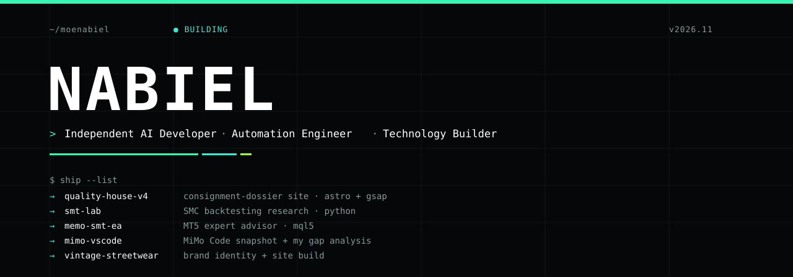

  

# Hi, I'm Nabiel

I'm an independent developer building real, working systems with AI and automation —
websites with real motion engineering, an OpenAI-compatible gateway over free LLM
providers, quantitative trading research, and MetaTrader expert advisors. I build in
public, ship what I start, and document honestly: everything on this profile is
labeled by its actual status — **active**, **research**, or **experimental**. Nothing
here is a tutorial clone.

## What I build

| Area | What that looks like |
|---|---|
| **AI applications & agents** | LLM gateway aggregating 16 free providers behind one endpoint; provider routing and fallbacks |
| **AI infrastructure** | Provider routing, proxying, rate-limit handling, OpenAI-compatible API design |
| **Websites & motion systems** | Production-grade Astro sites with GSAP + Lenis scroll choreography and design-token law |
| **Trading technology** | SMC backtesting research lab, event-driven fill simulation, MQL5 expert advisors |
| **Automation & tooling** | Build pipelines, zero-leak git workflows, browser-QA gates (Playwright), asset scanners |

## Stack (from real projects)

| Layer | Technologies |
|---|---|
| **Languages** | TypeScript · Python · JavaScript · MQL5 |
| **Web** | Astro · GSAP · Lenis · Vite · HTML/CSS design tokens |
| **AI / LLM** | OpenAI-compatible APIs · provider routing · prompt engineering |
| **Backend** | Node.js · Express-style servers · Docker |
| **Data / Quant** | Pandas · NumPy · walk-forward validation · backtesting engines |
| **Tooling & QA** | Playwright · axe-core · Gitleaks · GitHub Actions · gh CLI |
| **Desktop / Trading** | MetaTrader 5 · MQL5 expert advisors |

## Featured projects

<!-- statuses are honest: active / research / experimental -->

| Project | What it is | Stack | Status |
|---|---|---|---|
| [quality-house-v4](https://github.com/Moenabiel/quality-house-v4) | "The Consignment Dossier" — portfolio-grade site for a Sudanese agricultural export house, with paper-and-ink motion physics, page-turn transitions, and a scroll-driven 360° gum-tree rotation | Astro · TypeScript · GSAP · Lenis | **Active** |
| [freellmapi](https://github.com/Moenabiel/freellmapi) | 16 free LLM providers behind one OpenAI-compatible endpoint — routing, streaming, key handling | Node.js · TypeScript · Docker | **Active** |
| [smt-lab](https://github.com/Moenabiel/smt-lab) | Research framework for Smart Money Concepts backtesting: real fill-to-stop sizing, walk-forward validation, Streamlit desktop app | Python · Pandas | **Research** |
| [memo-smt-ea](https://github.com/Moenabiel/memo-smt-ea) | MetaTrader 5 EA framework — SMC entries, correlation engine, news-blackout scheduling | MQL5 | **Research** |
| [SMT-Divergence-EA](https://github.com/Moenabiel/SMT-Divergence-EA) | MetaTrader 5 expert advisor — SMT divergence entries on XAUUSD with disciplined risk sizing | MQL5 | **Research** |
| [motion-lab](https://github.com/Moenabiel/motion-lab) | Vanilla HTML/CSS/JS motion experiments — easing studies and reference shots | HTML · CSS · JS | **Sandbox** |

## Currently

- **Shipping:** the Quality House v4 site — aliveness passes, page transitions, scroll-driven tree rotation
- **Researching:** SMC strategy robustness — walk-forward + real fill simulation before any live claim
- **Building:** the free-LLM gateway (provider health, fallbacks, streaming correctness)
- **Practicing:** zero-leak engineering — every repo on this profile passed a Gitleaks gate before publish

## GitHub stats

  

## Contact

- GitHub — this profile. Open an issue on any repo, or start a discussion.

---

  

